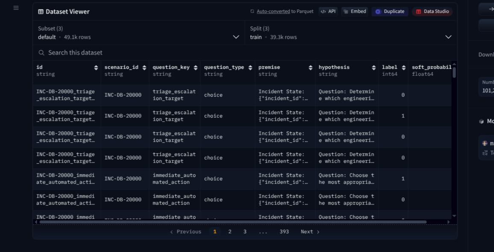
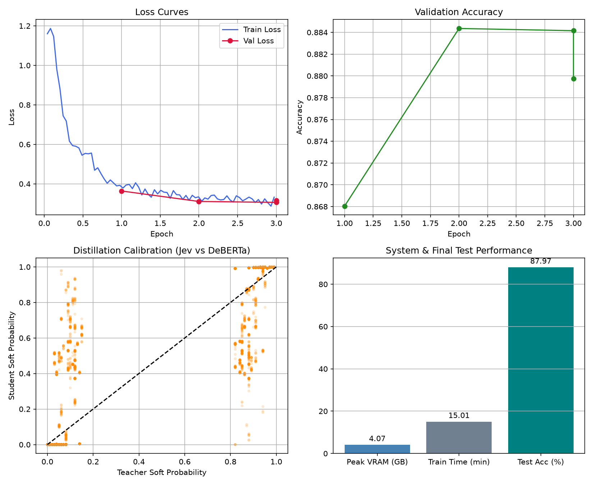

# Jev Distillation into DeBERTa_v3

**Author:** Martin Larrea (martin76ec)

## Problem

SRE triage problems require decision making using calibrated telemetry that is always structured. Most teams try to solve these scenarios using LLMs, which are not well suited for structured data given the required inference speed and the large context overhead needed for each call.

## Solution

I suggest using a BERT like model (DeBERTa, Jev). Since Jev is already good enough to handle most triage scenarios, distilling it into a local model offers major benefits in training and inference performance. This solution was previously discussed with the teacher and approved.

## Dataset

This is a synthetic dataset generated from combinations of infrastructure triage incident components. **The output is an actual answer from Jev (typesafe)**.

- **Dataset**: [martin76ec/infrastructure-incident-synthetic](https://huggingface.co/datasets/martin76ec/infrastructure-incident-synthetic)
- **Generator script**: [martin76ec/infrastructure-synthetic-dataset](https://github.com/martin76ec/infrastructure-synthetic-dataset)

The components of this dataset are:

- **choice**: Categorical escalation target routing.
- **noul**: Calibrated boolean evaluation (true/false probability).
- **score**: Ordered severity and impact levels.

It contains 39,290 training pairs, 4,903 validation pairs, and 4,914 test pairs.

## Differences from the original lab

1. **Judge**: Since the output is structured, there is no need for an LLM as a judge. We can do a direct mathematical comparison of the output values.
2. **DPO**: DPO is not appropriate here because we are not generating text. Instead, we use Knowledge Distillation with soft labels.
3. **Anti-toxicity**: Encoder classifiers cannot generate text, making conversational toxicity checks unnecessary.
4. **Base Model**: Used DeBERTa-v3-small instead of Qwen 2.5 1.5B for fast inference.

## Results

Trained on an RTX 4060 Ti (8GB) with LoRA (r=8, alpha=16) in bf16.

- **Validation Accuracy**: 88.42%
- **Validation Loss**: 0.3063
- **Peak VRAM**: 2.61 GB
- **Training Time**: 15 minutes (3 epochs)
- **Inference Latency**: < 12 ms per batch
- **Model Checkpoint**: [martin76ec/deberta-infrastructure-triage-distill](https://huggingface.co/martin76ec/deberta-infrastructure-triage-distill)

Live inference was recorded as [output/run_record.mp4](output/run_record.mp4)

_Note: Even if the metrics are good, I've trying using different inputs to src/run_model.py, and the results are not good at all. So probably BERT like models are not enough to achieve Jev's inference mechanisms._
